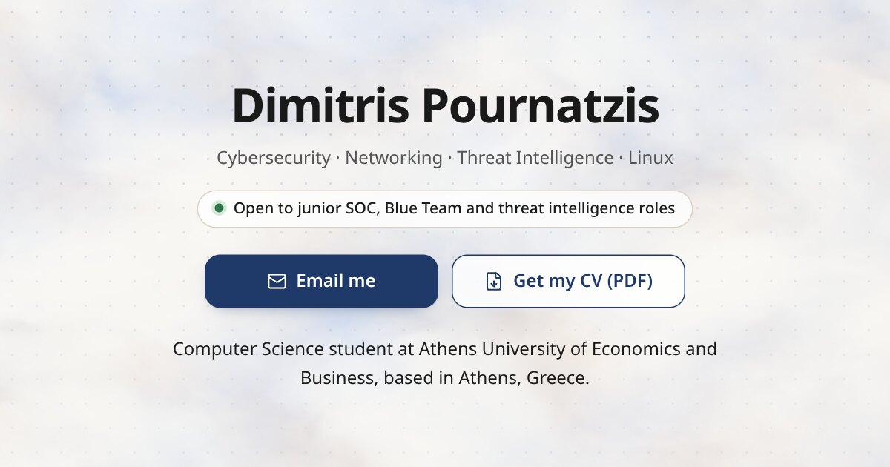
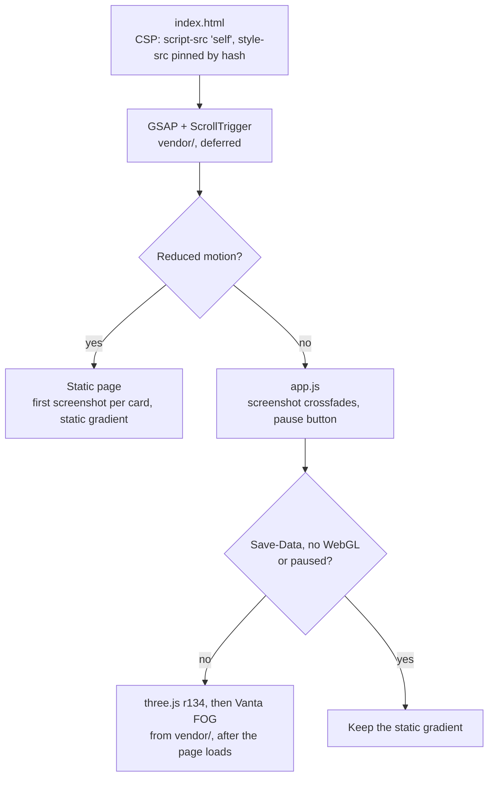

# dimpourn.github.io

<p align="center">
  <a href="https://dimpourn.github.io/">
    
  </a>
</p>

<p align="center">
  <a href="https://dimpourn.github.io/"><b>Live site</b></a> ·
  <a href="https://dimpourn.github.io/DimPournCV/">Interactive CV</a> ·
  <a href="https://dimpourn.github.io/Dimitris-Pournatzis-CV.pdf">PDF CV</a> ·
  <a href="https://dimpourn.github.io/sh_lab/">Homelab</a> ·
  <a href="https://www.linkedin.com/in/dimpournatzis/">LinkedIn</a>
</p>

The source of my link-in-bio page. I'm a Computer Science student (cybersecurity path) at AUEB in
Athens, looking for a junior SOC, Blue Team or threat intelligence role. The page points to my
work and my contact details. It is one static HTML file plus a small motion script: no build step,
a strict Content Security Policy and no third-party requests.

## The page

- **Hero:** photo, name, focus areas, the roles I'm looking for, and buttons to email me or
  download my CV.
- **Find my work:** cards for my homelab site, my interactive CV, GitHub and LinkedIn, each with
  real screenshots of the page it links to.
- **Featured projects:** my security homelab, Sentinel Linux (a local workspace for CISA KEV and
  FIRST EPSS data) and Cyber Case Lab (a workbench for practising investigations).
- **Let's talk:** email and links.

The motion is optional:

- GSAP crossfades each screenshot stack, only while it is on screen.
- Vanta FOG draws a moving background after the page has loaded. It is skipped with Save-Data
  and without WebGL; the page then keeps its static gradient.
- One pause button stops every loop and the fog (WCAG 2.2.2), and the page remembers the choice.
- With reduced motion or without JavaScript, every card shows its first screenshot and nothing
  moves.

## How the page loads



## Security posture

| Control | Implementation | How to check |
| --- | --- | --- |
| Content Security Policy | `default-src 'none'`, `script-src 'self'`, `style-src` pinned to the sha256 of the one `<style>` block, `img-src 'self' data:`, `base-uri 'none'`, `form-action 'none'`; no inline scripts and no `style=""` attributes | The browser console shows no violations; the hash command under [Editing the page](#editing-the-page) matches the policy |
| No third-party requests | System fonts, an inline SVG icon sprite and self-hosted libraries | `default-src 'none'` blocks every other origin |
| Pinned dependencies | GSAP 3.13.0; three.js r134 and Vanta 0.5.24, both checked against the `vanta@0.5.24` npm tarball | [`vendor/README.txt`](vendor/README.txt) |
| Clean media | The photo, screenshots and link preview carry no EXIF, GPS or XMP data; the CV PDF has no embedded attachments | `magick identify -verbose <file>`, `qpdf --list-attachments <pdf>` |
| Vulnerability contact | [`security.txt`](.well-known/security.txt) (RFC 9116), covering every site under dimpourn.github.io | — |

Known limits: GitHub Pages cannot set HTTP headers, so `frame-ancestors`, HSTS and
`X-Content-Type-Options` are not available. The two scripts that draw the fog are loaded on demand
and are not yet pinned with Subresource Integrity.

## Preview locally

Run this in the repository root, then open <http://127.0.0.1:8000/>:

```sh
python3 -m http.server --bind 127.0.0.1 8000
```

Binding to `127.0.0.1` keeps the server off your local network.

## Editing the page

- **A CSS change needs a new hash.** The policy allows only the exact `<style>` block it was made
  for, so after any CSS edit the page loads unstyled until the hash is updated. This prints the
  current hash and whether the policy already has it:

  ```sh
  python3 -c "import re,hashlib,base64;s=open('index.html').read();b=re.search(r'<style>(.*?)</style>',s,re.S).group(1);h=base64.b64encode(hashlib.sha256(b.encode()).digest()).decode();print(h,'matches the CSP' if h in s else 'not in the CSP: update style-src')"
  ```

- **Screenshots** in `previews/` are captured at 1280×800 and saved as WebP twice, 640 and
  1280 px wide, for `srcset`. Strip metadata when saving, for example
  `magick in.png -strip -quality 80 out-1280.webp`.
- **Caching:** GitHub Pages lets browsers keep files for 10 minutes. After changing `app.js`,
  add a version query to its tag (`app.js?v=2`) so returning visitors get the new file.

## Repository layout

| Path | Contents |
| --- | --- |
| `index.html` | The page: markup, the one `<style>` block, the icon sprite and the CSP |
| `app.js` | Motion layer: crossfades, Vanta fog, pause button |
| `avatar.webp` | Profile photo |
| `og.jpg` | 1200×630 link preview |
| `previews/` | Screenshots used by the cards |
| `vendor/` | GSAP, three.js and Vanta, with their licences |
| `Dimitris-Pournatzis-CV.pdf` | The PDF CV, also linked from the interactive CV |
| `.well-known/security.txt` | Security contact for the whole domain |
| `.nojekyll` | Tells GitHub Pages to serve the files as they are, without Jekyll |

## License

© Dimitris Pournatzis. My own text, design, code and photo are licensed under
[CC BY-NC-ND 4.0](LICENSE.md). The screenshots show my own projects and profiles; the GitHub and
LinkedIn interfaces in them belong to their owners. Third-party files keep their own licences:
GSAP (standard no-charge licence), three.js and Vanta (MIT), Lucide icons (ISC) and the Bootstrap
Icons GitHub and LinkedIn marks (MIT). See [`vendor/README.txt`](vendor/README.txt).
